<div align="center">

# ByteHomeDash

**The family wall calendar and the smart home dashboard, in one screen.**

The family's calendar, meals, tasks and lists next to the whole house, music, a voice assistant that knows who's talking and an optional video intercom, on one portrait touch screen driven by a Raspberry Pi 5 or a Radxa Rock 5B and Home Assistant.

[](https://github.com/jgvsaramago/bytehomedash/releases)
[](https://hacs.xyz/docs/faq/custom_repositories/)
[](LICENSE)
[](https://github.com/jgvsaramago/bytehomedash/actions/workflows/translations.yml)
[](https://ko-fi.com/H6L329JLEM)

<a href="https://youtu.be/K4Ck8zx9_Qo">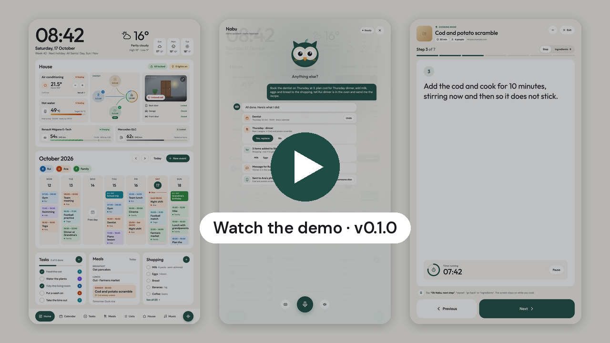</a>

▶ **[Watch the v0.1.0 demo on YouTube](https://youtu.be/K4Ck8zx9_Qo)**

[Features](#features) · [What you need](#what-you-need) · [Getting started](#getting-started) · [Documentation](https://github.com/jgvsaramago/bytehomedash/wiki) · [Roadmap](#roadmap) · [Contributing](#contributing)

</div>

## Why

I built ByteHomeDash to solve my own problem. I wanted a **family wall panel** at home, with the shared calendar, the week's meals, the chores and the shopping list, and I already had a **smart home dashboard** in Home Assistant for the lights, climate, energy and cameras. I couldn't find one screen that did both well, so I made it.

The two belong together: tonight's dinner opens in Cooking mode, the assistant plans the meals and puts what's missing on the shopping list, a message left by voice pops up the next time the screen wakes, and the doorbell interrupts whatever is on screen. The family organiser is kept in Home Assistant, so it works with your calendars and to-do lists, and every screen in the house shows the same.

A screen on the kitchen wall is used differently from a phone: by the whole family, at a glance, from across the room, with wet hands or by voice. ByteHomeDash is a dedicated app for that screen. It runs full screen with no desktop, wakes on a touch, the wake word or the doorbell, and is set up from Home Assistant instead of on the screen itself.

## Features

### ⚡ Straight to the screen, no desktop
- The app draws straight to the display through Linux DRM/KMS with [flutter-pi](https://github.com/ardera/flutter-pi): no X11, no Wayland, no window manager, and not a web page in a kiosk browser.
- A **Lite / Minimal OS without a graphical interface** is all it needs, so the board's CPU, GPU and memory go to the dashboard: smooth animations, live video and a voice assistant on a small board, a fast boot and less to break.

### 🏠 Home at a glance
- Climate, energy flow, cars and locks at the top; this week's calendar, today's tasks, meals and shopping list below.
- Tap a card to go deeper, or a value to see its history.

<p align="center">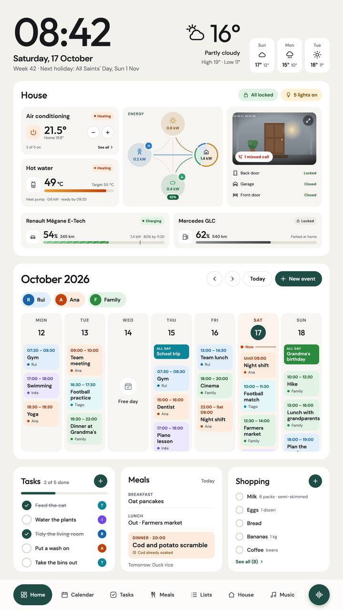 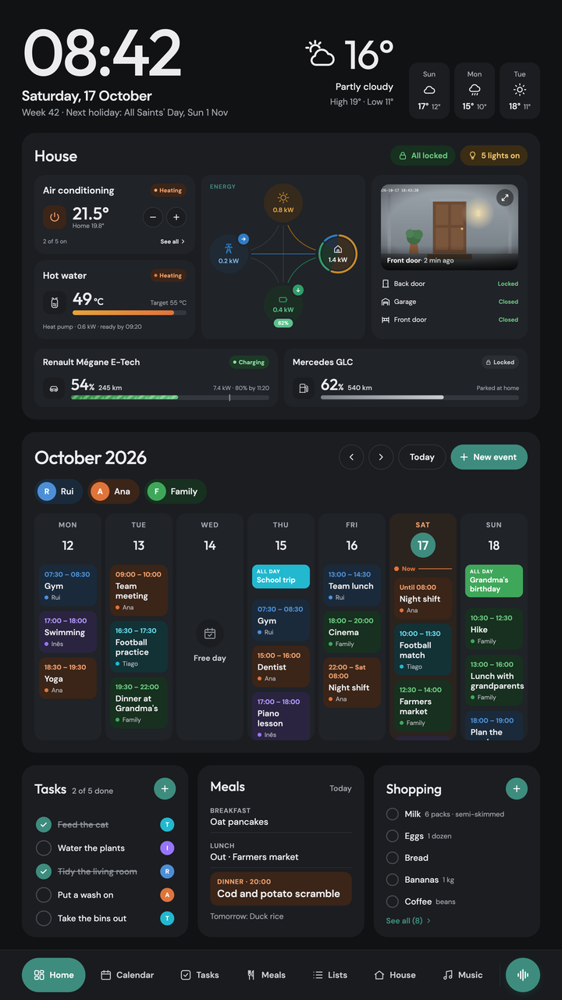</p>

### 📅 Family calendar
- Day, week, month and agenda views of the household's calendars, each person in their own colour.
- New events go straight into the right person's calendar, multi-day events included.
- Weather and the forecast in the header, with an hourly and daily view.

<p align="center">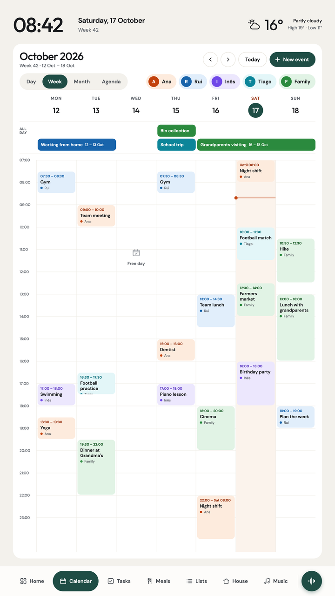</p>

### ✅ Tasks
- Household tasks per person, once or repeating on chosen weekdays, ticked off day by day.

<p align="center">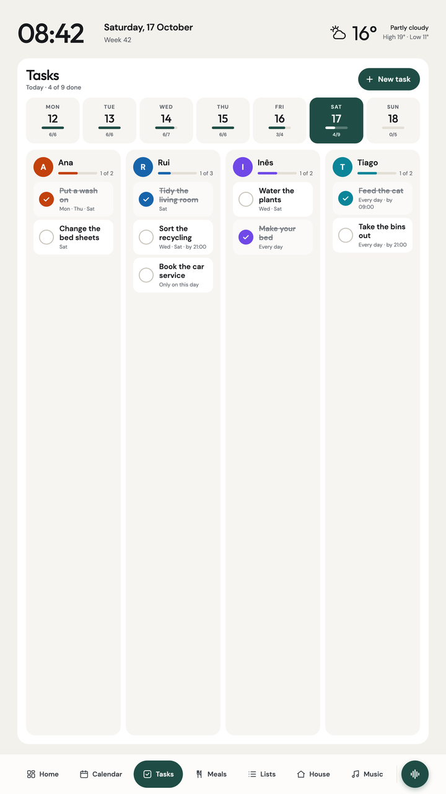</p>

### 🍽️ Meals and Cooking mode
- The week's meal plan: breakfast, lunch and dinner, at home, out or delivered, with a link to the recipe.
- **Cooking mode** shows a recipe one step at a time, large enough to read across the kitchen:
  - timers start from a step that mentions minutes, and keep counting on other steps;
  - tick off ingredients, and rescale them for more or fewer people;
  - "next step", "repeat", "go back" by voice;
  - **minimise it to a bubble** that shows the next timer, and use the rest of the screen meanwhile; tap the bubble (or say "back to the recipe") to return.

<p align="center">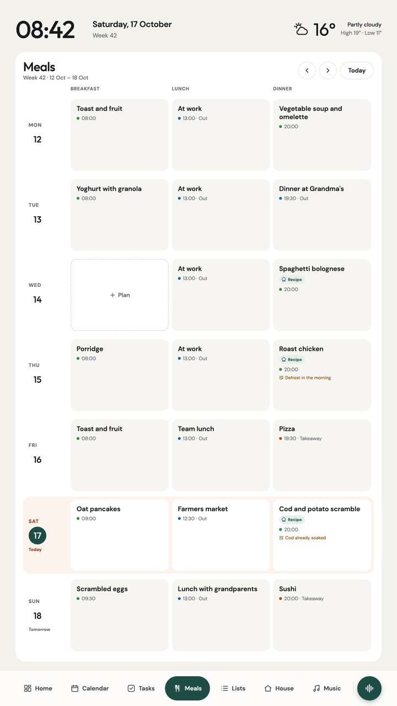 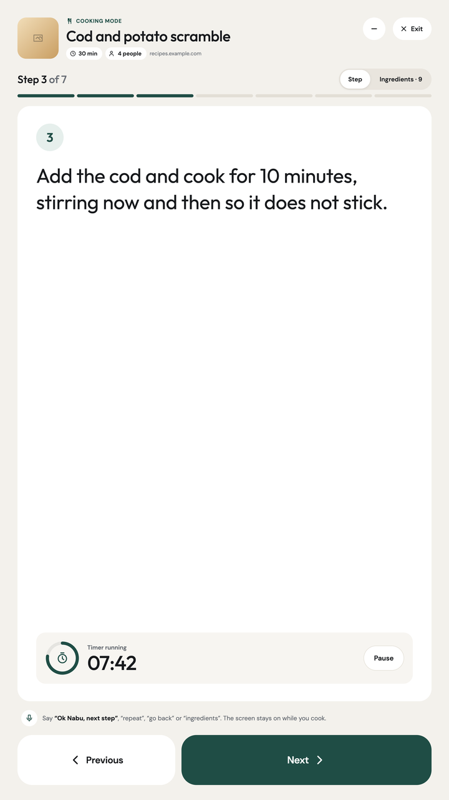</p>

### 📝 Lists and messages
- Your Home Assistant to-do lists (shopping and others), with quantities and quick suggestions.
- **Messages** for the family: write one by hand or say "leave a message for Ana: dinner is in the oven". It pops up the next time the screen wakes, until someone marks it seen, and can go to the person's phone too.

<p align="center">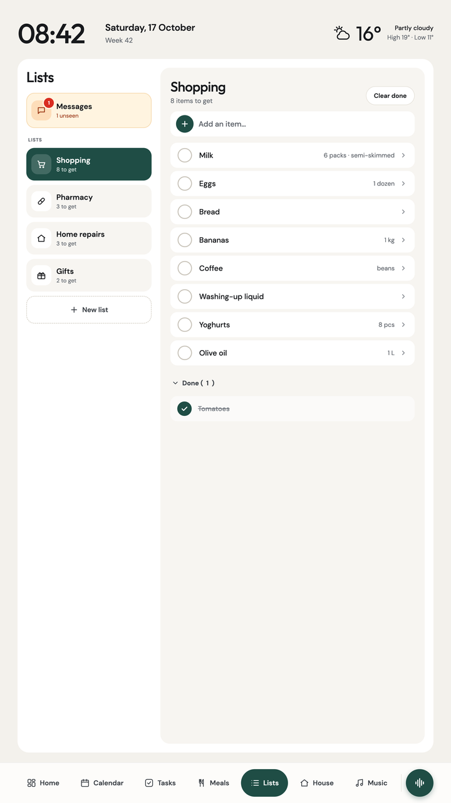 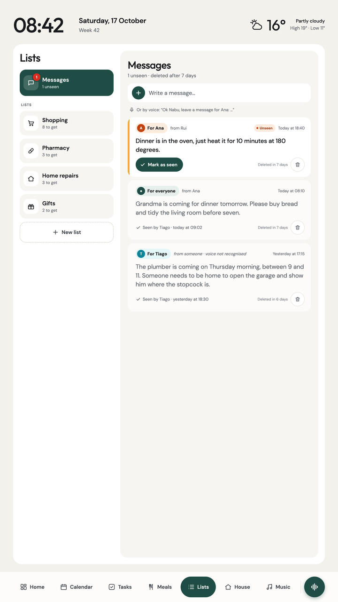</p>

### 🏡 The whole house
- **Rooms:** lights and brightness, blinds, air conditioning, ventilation and windows, per room.
- **Climate:** every air conditioner and heater at once, or room by room; the water heater.
- **Energy:** live solar, battery, grid and home flow, today's totals and the solar forecast, from Home Assistant's Energy dashboard.
- **Cars:** electric or fuel, battery or fuel level, range, charging and locks.
- **Robot vacuums:** status, maps, cleaning by room, and maintenance.
- **Cameras and locks:** live camera views and the locks and gates.

<p align="center">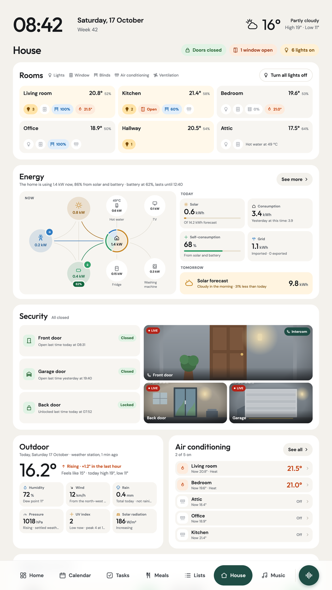 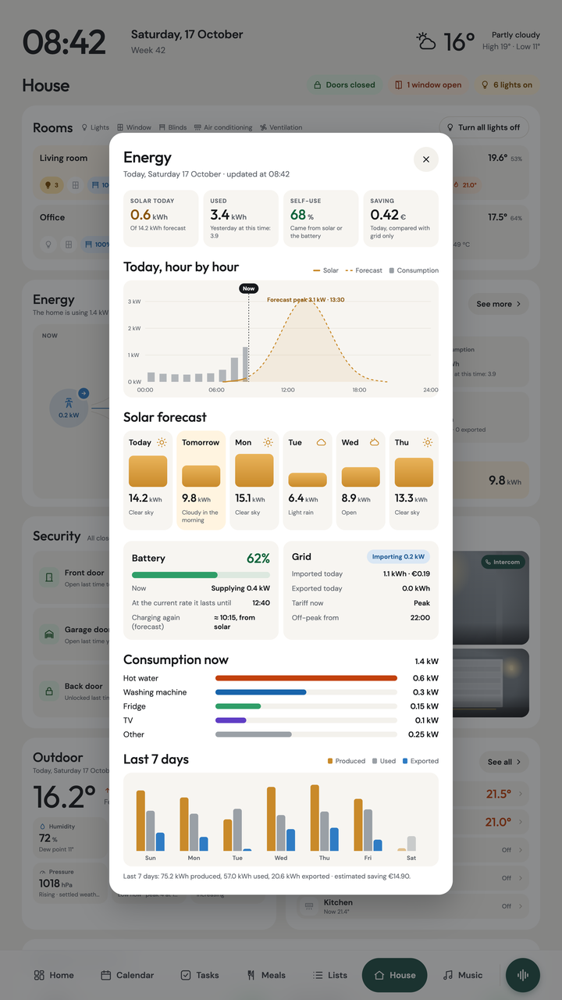</p>

### 🎵 Music
- [Music Assistant](https://music-assistant.io/) on the wall: what's playing, the speakers and groups, and the library.

<p align="center">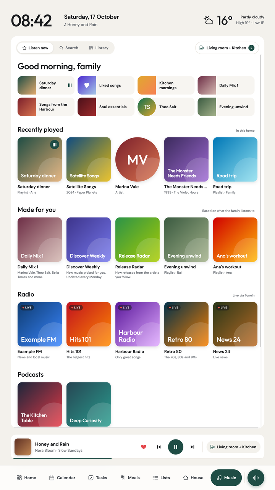</p>

### 🎙️ Voice assistant that knows who's talking
- **It recognises each member of the family by voice**, locally on the board, and acts on **that person's own things**:
  - "what's on **my** calendar tomorrow?" reads your calendar, and "book **me** the dentist on Thursday at 3" puts it there;
  - "add bread to **my** list" uses your own to-do list;
  - "add a task for **me**" assigns it to you, and "**I** took out the rubbish" ticks it off;
  - "send **me** that recipe" goes to your phone, and a message you leave says it's from you;
  - the screen shows who it recognised.
- Recognition is a convenience, not a password. The agent is told it's a similarity match and never to use it to unlock, open, disarm or buy anything, or to reveal anything sensitive; with an unrecognised voice, it's told not to guess who it is or use anyone's personal data. Only voice prints are kept, never recordings; each person registers their voice on the screen by reading five phrases.
- Talk to the screen with a wake word: the conversation shows on screen, the answer appearing as it's spoken.
- Web results become cards (recipes, products, videos, news) you can open or send to a phone.
- Tools for an LLM agent that go beyond Assist: plan meals from what's in the fridge, read a recipe step by step, make calendar events and tasks, leave messages, and say who rang the doorbell.
- Runs [Linux Voice Assistant](https://github.com/jgvsaramago/linux-voice-assistant) with a reSpeaker microphone, as an ESPHome satellite of Home Assistant's Assist.

<p align="center">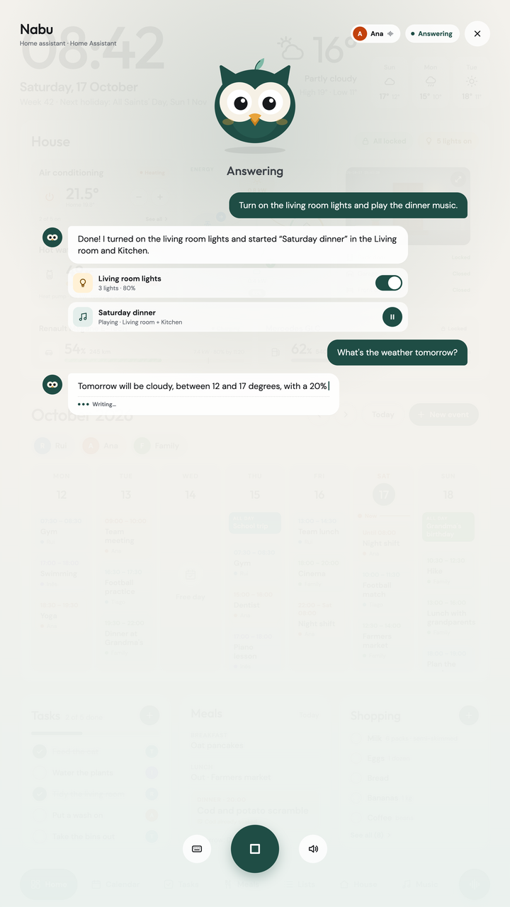 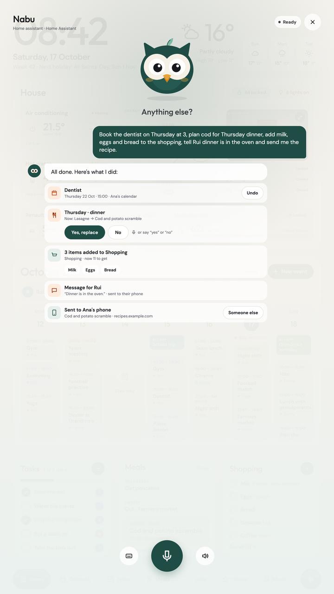</p>

### 🚪 Video intercom (optional)
- Answer a Hikvision door station from the screen, with live video, two-way audio and door opening; no Asterisk or cloud in the way.
- The screen rings like a real indoor station, and keeps a call history with a picture of every ring.
- Without an intercom, the screen simply shows your cameras in its place.

<p align="center">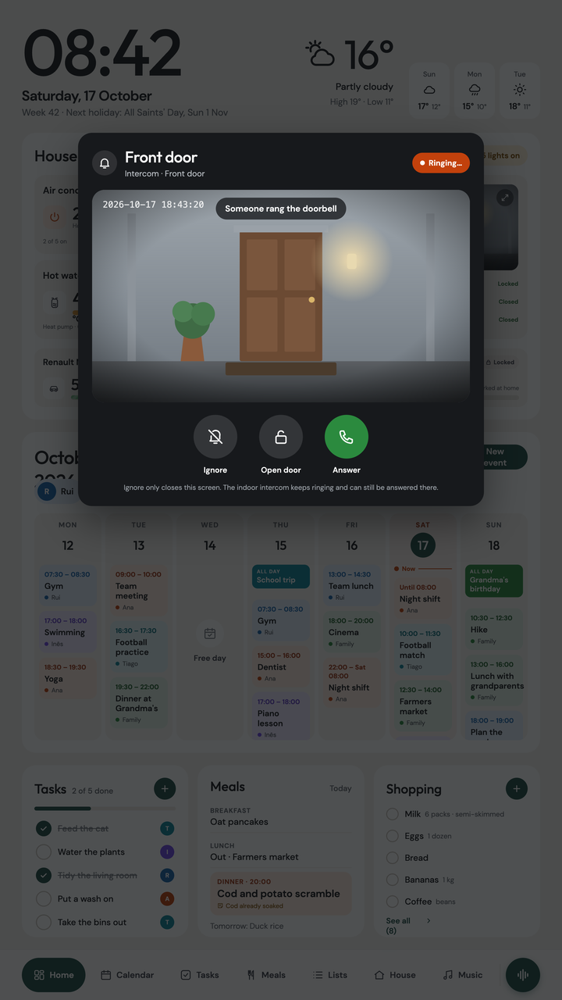 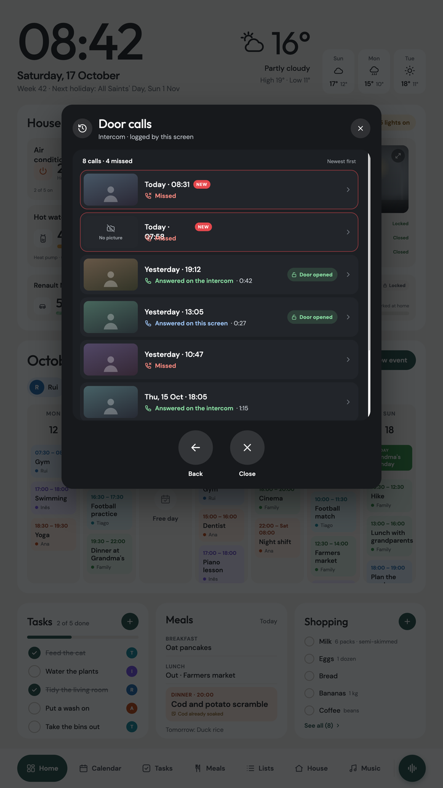</p>

### 🌐 Browser
- A web browser in a floating window, a modal or full screen, with its own volume, favourites and a home page of your choice.
- Add the page you're on to a meal, or send it to a phone.
- **Minimise it to a bubble:** the page and its sound keep going while you use the rest of the screen. Drag a bubble anywhere and it springs to the nearest edge.

<p align="center">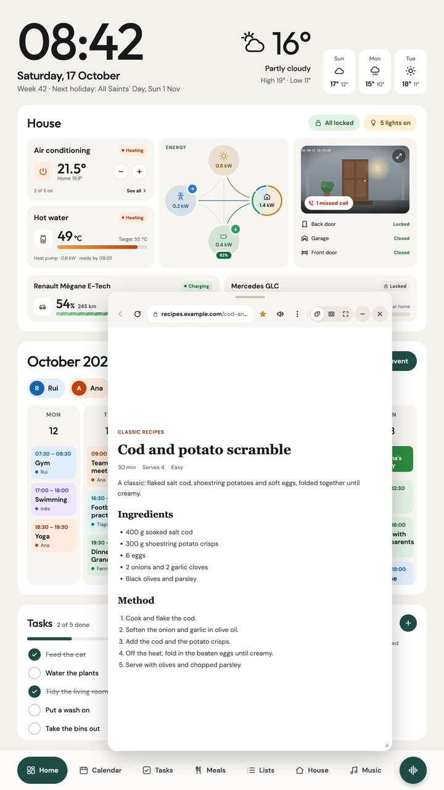 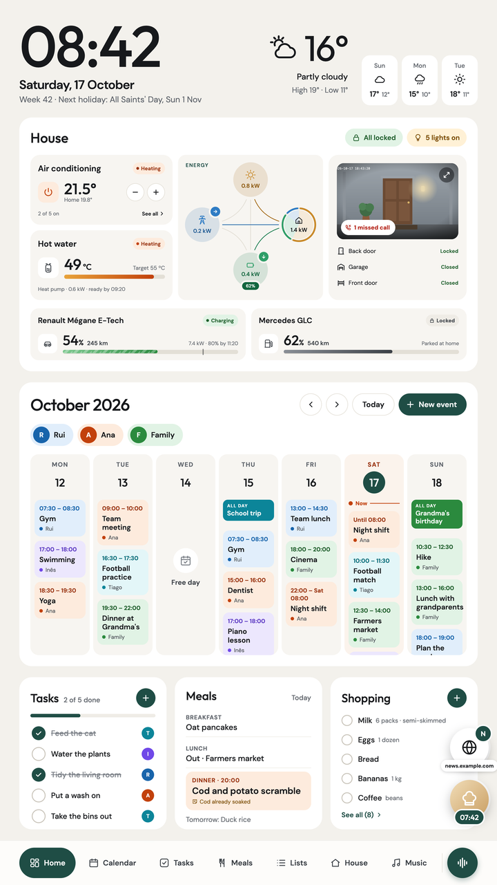</p>

### 🖥️ The screen in Home Assistant
- Each screen is a device in Home Assistant over MQTT: the panel as a light (on/off and brightness through DDC/CI), theme, volume, restart and shutdown, and the board's vitals.

### 🎨 And also
- **Light and dark themes**, switched by hand, by sunset or by an automation.
- **Configured from Home Assistant:** a sidebar panel picks every entity the screen shows, with best guesses filled in on first start. Several screens share the same settings and household data.
- **Languages:** English and Portuguese, following Home Assistant's language. [More are welcome](CONTRIBUTING.md#translations).

<p align="center">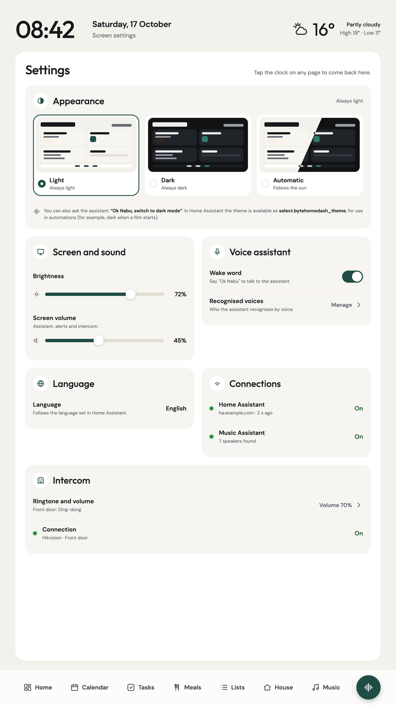</p>

## What you need

| | |
|---|---|
| **Board** | Raspberry Pi 5 or Radxa Rock 5B |
| **Screen** | A portrait touch monitor over HDMI, ideally with DDC/CI for brightness and standby ([tested monitors](https://github.com/jgvsaramago/bytehomedash/wiki/Hardware#monitor)) |
| **Home Assistant** | 2024.8 or later, with [HACS](https://hacs.xyz/) |
| **Optional** | An MQTT broker (the screen's controls in Home Assistant) · a Seeed reSpeaker XVF3800 (voice) · a Hikvision door station and indoor station (intercom) |

## Getting started

**1. Install the integration in Home Assistant**

[](https://my.home-assistant.io/redirect/hacs_repository/?owner=jgvsaramago&repository=bytehomedash&category=integration)

Download **ByteHomeDash** in HACS, restart Home Assistant and add the integration. Then open **ByteHomeDash** in the sidebar and check what it picked, and create a long-lived access token for the screen (your profile → Security).

**2. Set up the board**

Install Raspberry Pi OS Lite on a Pi 5, or Armbian Minimal with the **current** kernel on a Rock 5B (not the *vendor* Rockchip kernel). Then connect to the board with SSH and run:

```sh
sudo apt update && sudo apt install -y git
git clone https://github.com/jgvsaramago/bytehomedash.git ~/src/bytehomedash
cd ~/src/bytehomedash/device && sudo sh setup.sh
```

The setup installs everything, including the latest app release. Put your Home Assistant URL and a long-lived token in `/etc/bytehomedash.env`, reboot, and the screen comes up.

**3. Optional: the voice assistant**

Plug a reSpeaker XVF3800 into the board, run the setup again and add the screen to Home Assistant's ESPHome integration. Then, in your LLM conversation agent's options, select **ByteHomeDash** next to Assist under *Control Home Assistant*. Without that, the assistant can't plan meals, open Cooking mode, show web results or know who is speaking. See the [Voice assistant](https://github.com/jgvsaramago/bytehomedash/wiki/Voice-assistant#turn-on-the-agent-tools) page.

**New to this?** The wiki's **[Installation guide](https://github.com/jgvsaramago/bytehomedash/wiki/Installation)** walks you through every step, from writing the card to the first start, with no programming knowledge needed.

## Documentation

The **[wiki](https://github.com/jgvsaramago/bytehomedash/wiki)** has the details:

- [Hardware](https://github.com/jgvsaramago/bytehomedash/wiki/Hardware) and [Installation](https://github.com/jgvsaramago/bytehomedash/wiki/Installation)
- [Home Assistant integration](https://github.com/jgvsaramago/bytehomedash/wiki/Home-Assistant-integration): the panel and what the screens need
- [Using the screen](https://github.com/jgvsaramago/bytehomedash/wiki/Using-the-screen), the [Voice assistant](https://github.com/jgvsaramago/bytehomedash/wiki/Voice-assistant) and the [Intercom](https://github.com/jgvsaramago/bytehomedash/wiki/Intercom)
- [Configuration](https://github.com/jgvsaramago/bytehomedash/wiki/Configuration), [Updating](https://github.com/jgvsaramago/bytehomedash/wiki/Updating) and [Troubleshooting](https://github.com/jgvsaramago/bytehomedash/wiki/Troubleshooting)
- [Development](https://github.com/jgvsaramago/bytehomedash/wiki/Development): building, the code layout and releases

[`device/README.md`](device/README.md) covers the board setup step by step.

## How it fits together

| Part | Runs on | What it does |
|---|---|---|
| **App** (`lib/`) | the board | A Flutter app shown full screen by [flutter-pi](https://github.com/ardera/flutter-pi), straight on the display with no desktop. Talks to Home Assistant over its WebSocket API. |
| **Integration** (`custom_components/bytehomedash/`) | Home Assistant | The settings panel, the household data the screens share (meal plan, tasks, messages), and the agent tools. |
| **Board setup** (`device/`) | the board | OS packages, flutter-pi, the services, boot splash, audio, the voice assistant and, if you have one, the intercom. |

App and integration are released together: each [release](https://github.com/jgvsaramago/bytehomedash/releases) has the app already built and the integration HACS installs.

## Roadmap

Ideas for where ByteHomeDash goes next. Suggestions and help are welcome: open an issue to discuss one before starting.

**Make it yours**
- **Modular Home and House pages:** a grid layout instead of fixed pages, so each screen can show its own arrangement: the kitchen screen leads with meals and timers, the hallway one with the door and the cars. Arranged from the Home Assistant panel per screen, and shareable as a layout file, so the app fits other households and projects too.
- **A catalogue of grid widgets:** today's cards (calendar week, tasks, meals, shopping, energy flow, climate, cars, cameras, locks, vacuums, music, messages, intercom) as widgets in sizes that fit the grid, plus generic ones for any entity: a value, a switch, a graph, a camera, a button for a script or scene.
- **Other screen shapes:** landscape and smaller panels, from the same widgets.

**For the family**
- **Personal views:** when the assistant recognises who is speaking, or presence says who is home, show their own calendar, tasks and messages first.
- **A recipe box:** keep the recipes you cook, rescale them, and turn a week of meals into the shopping list.
- **Photo frame:** photos from Home Assistant's media or your photo library while nobody is using the screen.
- **Alerts from Home Assistant:** "the washing machine is done" as a banner on the screens, from an automation.

**Hardware and setup**
- **A ready-made image** to flash, instead of running the setup, and more tested boards and monitors.
- **More languages**, through a translation platform like Weblate.

## Contributing

Issues and pull requests are welcome: bug reports, fixes, more hardware, new features and **translations**. See [CONTRIBUTING.md](CONTRIBUTING.md).

## Support

If ByteHomeDash is useful to you, you can buy me a coffee:

[](https://ko-fi.com/H6L329JLEM)

## License

ByteHomeDash is free software under the [GNU General Public License v3.0](LICENSE): you can use, study, share and change it, and changes you distribute stay under the same licence.

Hikvision's HCNetSDK, which the optional intercom uses, is proprietary and isn't part of this repository or its releases; `setup.sh` downloads it separately (see [`device/hcnetsdk/README.md`](device/hcnetsdk/README.md)).

## Acknowledgements

- [Home Assistant](https://www.home-assistant.io/) and [Music Assistant](https://music-assistant.io/)
- [flutter-pi](https://github.com/ardera/flutter-pi), which runs Flutter without a desktop
- [Linux Voice Assistant](https://github.com/OHF-Voice/linux-voice-assistant) and NVIDIA's TitaNet for speaker identification
- [Hikvision-Addons](https://github.com/pergolafabio/Hikvision-Addons), for the aarch64 build of Hikvision's SDK
